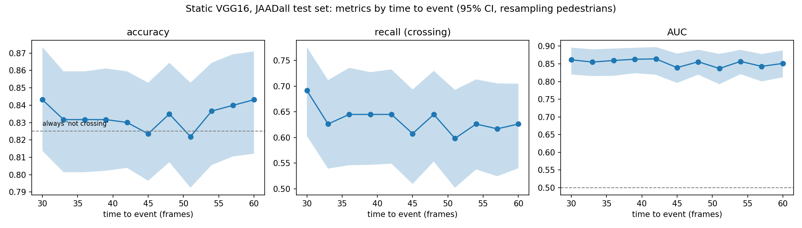

# Reproducing the Static VGG16 baseline on JAAD

A reproduction of the Static VGG16 baseline from the Pedestrian Action Benchmark
(Kotseruba, Rasouli, Tsotsos, WACV 2021), run on the JAAD dataset, with five random
seeds to measure run to run variation.

The task: given about half a second of dashcam video of a pedestrian, predict whether
they will start crossing 1 to 2 seconds later.

## Results

Mean and standard deviation over 5 seeds, against the single numbers reported in the paper.

| Setup | Metric | Paper | This repo |
|---|---|---|---|
| JAADall | Acc | 0.82 | 0.837 +- 0.011 |
| JAADall | AUC | 0.75 | 0.754 +- 0.010 |
| JAADall | F1 | 0.55 | 0.574 +- 0.018 |
| JAADall | Precision | 0.49 | 0.529 +- 0.027 |
| JAADall | Recall | 0.63 | 0.627 +- 0.017 |
| JAADbeh | Acc | 0.59 | 0.606 +- 0.021 |
| JAADbeh | AUC | 0.52 | 0.538 +- 0.022 |
| JAADbeh | F1 | 0.71 | 0.720 +- 0.016 |
| JAADbeh | Precision | 0.63 | 0.648 +- 0.013 |
| JAADbeh | Recall | 0.82 | 0.810 +- 0.023 |

Every paper value lies within about 1.5 standard deviations of the mean here. The means
sit slightly above the paper on most metrics. This is not evidence of an improvement,
since the paper reports one run per setup. Per-seed results are in results/seeds,
and the summary is in results/seeds/summary.txt.

## Analysis by time to event

The figure shows accuracy, recall for the crossing class and AUC as a function of
time to event (30 to 60 frames), for the Static VGG16 model on the JAADall test set.
It uses the saved predictions of one run (the baseline run, not the seed average).
Shaded bands are 95% intervals from resampling whole pedestrians, because samples
from the same pedestrian are not independent.

Only about 17.5% of the test samples are crossing, so a model that always predicts
"not crossing" already reaches about 0.825 accuracy. That is why recall and AUC are
shown next to accuracy, and why the accuracy panel includes that baseline.

What the curves show: accuracy stays between 0.82 and 0.84 at every time point,
which is essentially the "always not crossing" baseline. Recall for crossing
pedestrians is about 0.60 to 0.69 and AUC is about 0.84 to 0.86, with no clear
trend over time to event. The AUC intervals overlap at every time point, so the
differences between time points are within noise.

A note on AUC: the AUC in the results table (0.754) is the AUC of hard 0/1
predictions, which equals the mean of recall on crossing and on non-crossing
pedestrians. The AUC in this figure is computed from the model's probabilities, and
is higher (0.853 over all samples pooled). The two are not comparable, and only the
first one corresponds to the numbers reported by the benchmark.

Limitations: this is a single trained model. The paper's own breakdown by time to
event may use different bins, so this is an analysis in the same spirit and not a
reproduction of that figure. The script is scripts/plot_tte_metrics.py.

## Setup used

* Ubuntu 22.04, one RTX 2080 Ti, Python 3.9, TensorFlow 2.10.1, numpy 1.23.5
* conda packages: cudatoolkit 11.2, cudnn 8.1.0
* The authors' Dockerfile uses an unpinned TensorFlow image, so these versions are my choice
* No Docker was available on the server, so I recreated the environment with conda
* The config is the authors' Static_vgg16 config with the PIE entries removed.
  Hyperparameters are unchanged: 10 epochs for jaad_all and 5 for jaad_beh.

## How to run

1. Download JAAD and split the clips into frames, following the JAAD repository
   (https://github.com/ykotseruba/JAAD).
2. Clone https://github.com/ykotseruba/PedestrianActionBenchmark and copy jaad_data.py
   and pie_data.py (from https://github.com/aras62/PIE) into it. The benchmark imports
   pie_data even for JAAD only runs.
3. Copy scripts/seed_run.py and scripts/run_seeds.py into the benchmark folder, and
   configs/ into its config_files folder.
4. Set JAAD_PATH to your JAAD folder, choose a GPU, and run:

       export JAAD_PATH=/path/to/JAAD
       export CUDA_VISIBLE_DEVICES=0
       python run_seeds.py
       python scripts/summarize_seeds.py

   seed_run.py sets the Python, numpy and TensorFlow seeds and then runs the
   authors' train_test.py unchanged.

## Limitations

* Five seeds is a small sample, so the standard deviations are rough.
* GPU operations are not fully deterministic, so a fixed seed does not guarantee
  identical numbers.
* The authors' code fixes its own seed (42) for sample balancing, so that part of the
  data sampling does not vary between my seeds.
* I did no hyperparameter tuning.

## Credits

All model and benchmark code is by the paper's authors. This repo contains only the
seed wrapper, the run scripts, the config files adapted from theirs, and my results.
Please check the licenses of the original repositories if you reuse their code.
